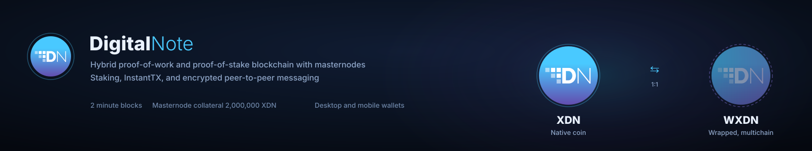

DigitalNote Daemon/QT-Wallet
============================================

DigitalNote (XDN) Hybrid PoW/PoS blockchain with Masternode Support.
DigitalNote provides a lightweight blockchain with several avenues for passive income.
DigitalNote (SatoshiCore) is the core of the DigitalNote ecosystem and was developed from a bitcore base and
since morphing into its own unique blockchain system.

Official website: [► Digitalnote.org](http://www.digitalnote.org)
White paper: [► WHITEPAPER](https://digitalnote.org/wp-content/uploads/2020/02/DigitalNote_Whitepaper.pdf).

Support Contact
-------------------
Twitter: [► digitalnotexdn](https://twitter.com/digitalnotexdn)
Telegram: [► invite link](https://t.me/XDNDN)
Discord: [► invite link](https://discord.gg/4dUquty)

Current Release
-------------------
**v2.0.0.9** — Qt 6 migration, OpenSSL 3.x, Boost 1.91, and the voted-consensus
masternode payment system.

Release notes: [► docs/release-notes/v2.0.0.9.md](docs/release-notes/v2.0.0.9.md)

Ecosystem overview: [► the full map](docs/digitalnote_ecosystem_2026.svg) — wallets,
staking and masternodes, mining, the WXDN bridge, and encrypted messaging.

Voted consensus activates on mainnet at block **1,480,000**. Until then the
wallet behaves exactly as v2.0.0.8 did for payment selection — the machinery is
present but inactive, and no masternode is dropped from eligibility by
upgrading. v2.0.0.8 masternodes continue to count toward consensus.

**This release is not mandatory**, and the network protocol remains compatible
with v2.0.0.8 (protocol 62059; older clients still connect and sync).

Official download
-------------------
github releases: [► DigitalNoteXDN/DigitalNote-2](https://github.com/DigitalNoteXDN/DigitalNote-2/releases)

Build instructions:
-------------------
DigitalNote Builder project: [► DigitalNoteXDN/DigitalNote-Builder](https://github.com/DigitalNoteXDN/DigitalNote-Builder)

Per-platform notes in this repository:

* Linux: [► docs/build-lnx.md](docs/build-lnx.md)
* Windows: [► docs/build-msw.md](docs/build-msw.md)
* macOS: [► docs/build-osx.md](docs/build-osx.md)
* Unix (generic): [► docs/build-unix.md](docs/build-unix.md)

Other topics: [► Tor](docs/tor.md) · [► SSL for RPC](docs/ssl.md) · [► Translation process](docs/translation_process.md)

Specifications and General info
-------------------
DigitalNote uses 

	* Secp256k1
	* Leveldb
	* Boost 1.91.0
	* Berkeley DB 6.2.32
	* GMP 6.2.1
	* libevent 2.1.12
	* miniupnpc 2.2.4
	* OpenSSL 3.5.7
	* QRencode 4.1.1
	* Qt 6.8.3

General Specs

	* Block Spacing: 2 Minutes
	* Stake Minimum Age: 15 Confirmations (PoS-v3) | 30 Minutes (PoS-v2)
	* Masternode Collateral: 2,000,000 XDN
	* Mainnet P2P Port: 18092
	* Mainnet RPC Port: 18094
	* Testnet P2P Port: 28092
	* Testnet RPC Port: 28094

License
-------------------

DigitalNote [XDN] is released under the terms of the MIT license. See [COPYING](COPYING) for more
information or see https://opensource.org/licenses/MIT.

Development Process
-------------------

The `master` branch is regularly built and tested, but is not guaranteed to be
completely stable. [Tags](https://github.com/DigitalNoteXDN/DigitalNote-2/tags) are created
regularly to indicate new official, stable release versions of DigitalNote [XDN].

The Developer Team [Discord](https://discord.gg/4dUquty) should be used to discuss complicated or controversial changes before working
on a patch set.

Testing
-------------------

Developers work in their own trees, then submit pull requests when they think their feature or bug fix is ready.

The patch will be accepted if there is broad consensus that it is a good thing. Developers should expect to rework and resubmit patches if they don't match the project's coding conventions (see docs/coding.txt) or are controversial.

Testing and code review is the bottleneck for development; we get more pull
requests than we can review and test on short notice. Please be patient and help out by testing
other people's pull requests, and remember this is a security-critical project where any mistake might cost people
lots of money.

The master branch is regularly built and tested, but is not guaranteed to be completely stable. Tags are regularly created to indicate new stable release versions of DigitalNote.

Manual Quality Assurance (QA) Testing
-------------------

Changes should be tested by somebody other than the developer who wrote the
code. This is especially important for large or high-risk changes. It is useful
to add a test plan to the pull request description if testing the changes is
not straightforward.
